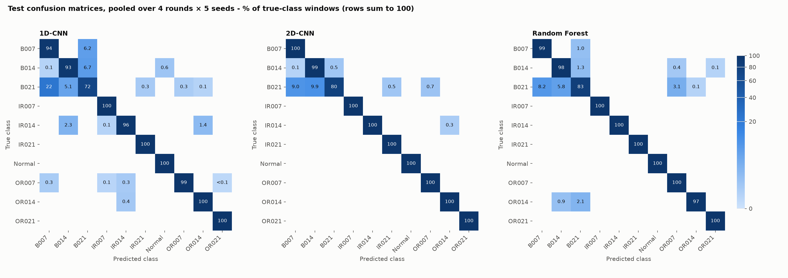
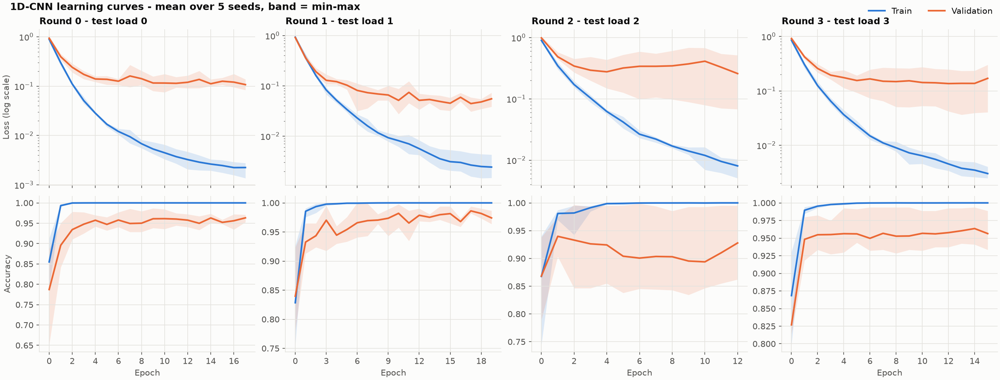
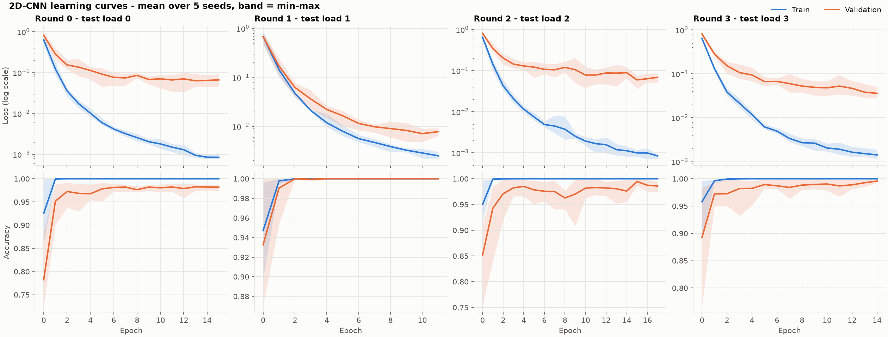

# bearing-fault-prediction

Classification of **10 bearing-fault classes** from raw vibration signals using the
[CWRU Bearing Data Center](https://engineering.case.edu/bearingdatacenter) dataset.

The project compares three models — a **1D-CNN**, a **2D-CNN** over log-spectrograms, and a
**Random Forest** over hand-crafted signal features — under a **leave-one-load-out** evaluation
protocol: models are always tested on a shaft load they never saw during training or model
selection.

---

## Results

Every model is trained **5 times per round with different seeds** (4 rounds × 5 seeds = 20 runs
per model) and scored on the held-out test load of its round. All tables and figures below are
produced by `python -m src.evaluate` (full tables in [`reports/summary.md`](reports/summary.md)).

| Model | Test accuracy | Test macro-F1 | Seed std (mean over rounds) | `B021` recall |
|---|---|---|---|---|
| **2D-CNN** | **0.9850 ± 0.0130** | 0.9758 ± 0.0228 | 0.0145 | 0.80 |
| **Random Forest** | 0.9832 ± 0.0162 | **0.9769 ± 0.0236** | **0.0021** | **0.83** |
| **1D-CNN** | 0.9652 ± 0.0165 | 0.9489 ± 0.0281 | 0.0312 | 0.72 |

Accuracy and macro-F1 are the mean over all 20 runs; **±** is the standard deviation across the
4 rounds (how much the test load matters). *Seed std* is the standard deviation across the 5 seeds
of a round, averaged over rounds (how much training randomness matters).

Per-round test accuracy (mean ± std over 5 seeds):

| Round | Test load | 1D-CNN | 2D-CNN | Random Forest |
|---|---|---|---|---|
| 0 | 0 HP | 0.9548 ± 0.0278 | 0.9912 ± 0.0039 | 0.9598 ± 0.0024 |
| 1 | 1 HP | 0.9501 ± 0.0194 | 0.9775 ± 0.0193 | 0.9874 ± 0.0022 |
| 2 | 2 HP | 0.9867 ± 0.0168 | 1.0000 ± 0.0000 | 0.9973 ± 0.0013 |
| 3 | 3 HP | 0.9693 ± 0.0608 | 0.9712 ± 0.0348 | 0.9884 ± 0.0024 |

**The 2D-CNN and the Random Forest are statistically tied.** Their means differ by 0.002, far less
than the round-to-round spread. The Random Forest is far more *reliable*: its result barely changes
with the seed, whereas a single CNN run can land several points above or below its mean (1D-CNN
round 3 ranges over ±0.06). The 1D-CNN is clearly the weakest.

### Confusion matrices



Pooled over all 20 runs per model; each row shows where the windows of one true class ended up
(raw counts: [`reports/confusion_counts.png`](reports/confusion_counts.png)). Almost all errors are
**among the three ball-fault sizes**: `B021` is mistaken for `B007` (1D-CNN 22 %, Random Forest
8 %) or `B014` (2D-CNN 10 %). Inner-race, outer-race and `Normal` windows are classified almost
perfectly; `Normal` is never confused with a fault in either direction by the 2D-CNN or Random
Forest. In other words, the models reliably detect *that* a ball is damaged but struggle with
*how badly*. `B021` has as many records as every other non-outer-race class (one per load), so
this is not a sample-size effect; ball faults at 0.021″ are a known hard case in CWRU.

### Overfitting check




Training loss keeps falling to ~10⁻³ while validation loss levels off around 10⁻¹ (except
2D-CNN round 1), and training accuracy reaches 100 % within 2–3 epochs. So both CNNs **fit the
training loads almost perfectly and pay a generalization gap on a new load**, but validation loss
does not climb back up. They stop improving rather than actively overfitting, and early stopping
on validation F1 keeps the best epoch. The 1D-CNN's round-2 validation curve has a very wide band:
some seeds generalize to the new load and others do not, which is the instability seen in its
seed std.

For the Random Forest, training accuracy is 1.000 in every round, out-of-bag accuracy 0.997–0.999,
validation 0.979–0.998 and test 0.960–0.997. Out-of-bag windows come from the training loads (and
overlap their neighbours), so the meaningful gap is OOB → test: about 1–4 points, again the cost
of an unseen load rather than memorization of individual windows. Per-round gap tables for all
models are in [`reports/summary.md`](reports/summary.md).

### How to read these numbers

- **Small differences are noise.** Windows cut from the same recording are not independent, and
  each test load contains exactly **one recording per class** (three for `OR007` and `OR021`).
  Per-class recall is effectively measured on a single recording, and 4 rounds give a very wide
  confidence interval on the mean. Repeating seeds measures training randomness, not this.
- **This is not a test on unseen bearings.** In CWRU each fault was seeded into one physical
  bearing that was then run at all four loads. Holding out a load removes the operating condition
  from training, but the test bearing itself was seen; models may partly learn bearing-specific
  signatures. Generalization to new bearings or machines is not measured here.

### Top Random Forest features

Mean impurity-based importance across the 4 rounds and 5 seeds:

```
  rms                0.1124      spec_3500-4000Hz 0.0723
  env_150-200Hz      0.0704      p2p              0.0644
  spec_500-1000Hz    0.0638      spec_0-500Hz     0.0636
  peak               0.0570      kurtosis         0.0526
  spec_1500-2000Hz   0.0482      spec_centroid    0.0458
```

---

## Dataset

The **CWRU Bearing Data Center** dataset (133 `.mat` files, ~480 MB) is vendored in `data/`.

| Directory | Files | Content | Used by the code |
|---|---|---|---|
| `data/12k_DE` | 60 | 12 kHz **drive-end** vibration, all fault types | **Yes** |
| `data/Normal` | 4 | Healthy baseline, 48 kHz (decimated to 12 kHz on load) | **Yes** |
| `data/12k_FE` | 45 | 12 kHz **fan-end** vibration | No — available but unused |
| `data/48k_DE` | 24 | 48 kHz drive-end vibration | No — available but unused |

### Filename convention

```
<Fault><Diameter>[@<Position>]_<Load>.mat
```

- **Fault** — `B` ball, `IR` inner race, `OR` outer race, `Normal` healthy
- **Diameter** — `007` / `014` / `021` / `028` → fault size 0.007″ / 0.014″ / 0.021″ / 0.028″
- **Position** — `@3` / `@6` / `@12` → outer-race fault clock position (outer-race files only)
- **Load** — `_0` … `_3` → motor loads of 0, 1, 2, 3 HP (≈1797, 1772, 1750, 1730 RPM)

### Classes

10 classes, encoded by a single shared `LabelEncoder` (fitted in `src/preprocess.py:main`) so
that integer labels are consistent across all rounds:

```
0: B007    1: B014    2: B021    3: IR007   4: IR014
5: IR021   6: Normal  7: OR007   8: OR014   9: OR021
```

### Notes on the data

- The `028` fault diameter (8 files) is **skipped** by `load_records()`: the dataset has no
  `OR028` counterpart, so including it would break class consistency.
- Records per class: one per load (4 in total) for every class except `OR007` and `OR021`, which
  have three clock positions per load (12 in total) and therefore ~3× as many windows. All
  models compensate with balanced class weights.
- `Normal` records are sampled at 48 kHz and are decimated by 4 (`scipy.signal.decimate`) to
  match the 12 kHz drive-end channel. See *Common low-pass* below for why this matters.
- `Normal_0.mat` is shorter than the other normal records, so `Normal` contributes fewer windows
  in rounds where load 0 is in the validation/test split.

---

## Repository layout

```
bearing-fault-prediction/
├── data/                      # CWRU dataset (133 .mat files)
├── src/
│   ├── config.py              # paths, sampling rate, window size, filter settings
│   ├── preprocess.py          # load → filter → window → split → normalize → save artifacts
│   ├── models.py              # CNN1D, CNN2D, log-spectrogram transform
│   ├── features.py            # 30 engineered features for the Random Forest
│   ├── app.py                 # Streamlit dashboard: dataset statistics + simulated live prediction
│   ├── evaluate.py            # confusion matrices, learning curves, summary tables -> reports/
│   └── train/
│       ├── common.py          # shared CNN training loop, scoring, summary
│       ├── cnn1d.py           # 1D-CNN over raw waveforms
│       ├── cnn2d.py           # 2D-CNN over log-spectrograms
│       └── randomforest.py    # Random Forest over engineered features
├── artifacts/                 # generated, git-ignored: windowed/normalized splits + prep metadata
├── models/                    # generated: checkpoints (seed 0), predictions + histories (all seeds)
├── reports/                   # generated: evaluation figures and summary.md
├── requirements.txt
├── LICENSE                    # Apache-2.0
└── README.md
```

Paths are resolved from `src/config.py`, so scripts work from any working directory; they are
run as modules (`python -m src....`) from the repository root so that `src` is importable.

---

## Setup

```bash
pip install -r requirements.txt
```

Developed and verified with **Python 3.13.5**; `requirements.txt` pins the direct dependencies
(`numpy`, `scipy`, `scikit-learn`, `torch` (CPU build, from PyTorch's CPU package index),
`joblib`, `pandas`, `streamlit`). For GPU training, install a CUDA build of `torch==2.14.1`
instead.

A GPU is used automatically when available — the CNN training loop selects `cuda` if
`torch.cuda.is_available()`, otherwise `cpu`. On CPU, training all three models (5 seeds each) takes ~50 minutes, most of it
the 2D-CNN.

---

## Usage

### 1. Build the shared artifacts (required first)

```bash
python -m src.preprocess
```

This loads every record, filters and windows it, performs the 4 leave-one-load-out splits,
normalizes using train-split statistics, and writes:

```
artifacts/data_test{0..3}.npz     # Wtr/ytr, Wva/yva, Wte/yte  (float32 waveforms, int64 labels)
artifacts/prep_test{0..3}.joblib  # mu, sd, LabelEncoder, load indices, fs, size, filter settings
```

### 2. Train and evaluate

Each script trains all 4 rounds × 5 seeds and prints per-round mean ± std over seeds, the
overall accuracy / macro-F1 and per-class recall.

```bash
python -m src.train.cnn1d          # -> models/cnn1d/
python -m src.train.cnn2d          # -> models/cnn2d/
python -m src.train.randomforest   # -> models/rf/
python -m src.evaluate             # -> reports/  (needs all three models' outputs)
```

The training scripts are independent — you can run any subset, but all of them require
`artifacts/` to exist. Re-run them whenever you rerun preprocessing with different settings.
Seed 0 of each round is the checkpoint used by the app; seeds 1–4 only save predictions and
training histories.

### 3. Dashboard

```bash
streamlit run src/app.py
```

Pick a round and model in the sidebar. The *Dataset statistics* tab shows class counts, per-class
RMS/kurtosis and spectra; the *Live prediction* tab streams held-out test windows (or an uploaded
CWRU `.mat` file) through the model window by window. The app refuses to load a checkpoint whose
saved preprocessing settings differ from the current artifacts. If `artifacts/` is missing (it is
git-ignored), the app builds it from `data/` on first start (~10 s).

### 4. Deploy to Streamlit Community Cloud

The repository deploys as-is: the trained checkpoints in `models/` are committed, and the app
builds `artifacts/` itself on first start.

1. Push the repository to GitHub.
2. On [share.streamlit.io](https://share.streamlit.io), create an app from the repository with
   branch `main` and main file path **`src/app.py`**.
3. Under *Advanced settings*, choose **Python 3.13** — the pickled Random Forest checkpoints and
   pinned library versions were produced with it.

`requirements.txt` installs the **CPU-only** PyTorch build through PyTorch's extra package index;
the default Linux wheel would pull several GB of CUDA libraries the app does not use. No secrets
are required. The first visit after each deploy or reboot waits for the artifact build; cloning
also downloads the ~480 MB dataset, so deploys take a few minutes.

---

## Methodology

### Signal pipeline (`src/preprocess.py`)

1. **Load** the `*_DE_time` array from each `.mat` via `scipy.io.loadmat`.
2. **Decimate** the normal (48 kHz) records by 4 to reach the 12 kHz drive-end rate.
3. **Low-pass** every record with the same filter (see below).
4. **Window** into 2048-sample segments. Training windows use `step = 1024` (50 % overlap);
   validation and test windows use `step = 2048` (no overlap) to avoid near-duplicate leakage.
5. **Remove DC** by subtracting each window's own mean.
6. **Normalize** with a global z-score computed from the **training split only** — validation and
   test statistics are never used.
7. **Save** the resulting splits as compressed `.npz` archives.

#### Common low-pass

`Normal` and the fault records come through different processing chains: above ~4.8 kHz the
decimated `Normal` spectrum follows `decimate()`'s anti-alias roll-off, while the native 12 kHz
records follow the recorder's own (about −39 dB vs −58 dB relative to the 3–3.5 kHz band, in the
top 5.75–6 kHz band). Left in, that difference lets a model identify `Normal` from how the file
was processed rather than from the bearing. Every record is therefore low-passed with an
8th-order elliptic filter at `LOWPASS = 4000` Hz (0.1 dB ripple, −80 dB stopband reached by
~4.5 kHz, applied zero-phase with `sosfiltfilt`). After filtering, the energy above 4.6 kHz is
at the same ~1e-6 floor for every class.

An optional extra **band-pass** (4th-order Butterworth, 500–4000 Hz) can be enabled with
`USE_BANDPASS = True` in `src/config.py`.

### Evaluation protocol — leave-one-load-out

For each round, one load is held out for testing, the next load (cyclically) for validation, and
the remaining two for training.

| Round | Test load | Validation load | Training loads |
|---|---|---|---|
| 0 | 0 (0 HP) | 1 (1 HP) | 2, 3 |
| 1 | 1 (1 HP) | 2 (2 HP) | 3, 0 |
| 2 | 2 (2 HP) | 3 (3 HP) | 0, 1 |
| 3 | 3 (3 HP) | 0 (0 HP) | 1, 2 |

Split sizes (windows of 2048 samples):

| Round | Train | Validation | Test |
|---|---|---|---|
| 0 | 3294 | 826 | 796 |
| 1 | 3235 | 826 | 826 |
| 2 | 3232 | 827 | 826 |
| 3 | 3291 | 796 | 827 |

Hyperparameters and early stopping use the **validation load only**, and the test load is scored
exactly **once** per round, with the best-validation model. Validation macro-F1 often reaches
1.0 within a few epochs, so model selection has little signal to work with; treat round-to-round
variance (e.g. CNN1D rounds 0–1) as genuine instability rather than tuning noise.

### Models

#### 1D-CNN — `src/models.py:CNN1D`

Input `(N, 1, 2048)` raw waveform.

```
Conv1d(1  → 16, k=64, stride=8) → BatchNorm1d → ReLU → MaxPool1d(2)   # 2048 → 128
Conv1d(16 → 32, k=3)           → BatchNorm1d → ReLU → MaxPool1d(2)   # 128  → 64
Conv1d(32 → 64, k=3)           → BatchNorm1d → ReLU → MaxPool1d(2)   # 64   → 32
Conv1d(64 → 64, k=3)           → BatchNorm1d → ReLU → MaxPool1d(2)   # 32   → 16
AdaptiveAvgPool1d(1) → Flatten → Dropout(0.3) → Linear(64, 10)
```

The wide 64-tap first kernel with stride 8 follows the WDCNN design for wide-first-kernel
convolution over raw vibration signals. ≈ 25 k parameters.

#### 2D-CNN — `src/models.py:CNN2D`

Input `(N, 1, 65, 61)` — `scipy.signal.spectrogram` with `nperseg=128`, `noverlap=96` produces
65 frequency bins × 61 time frames, converted to `log10` power. Bins above the 4 kHz low-pass sit
at the filter floor for every class.

```
Conv2d(1  → 16, 3×3) → BatchNorm2d → ReLU → MaxPool2d(2)   # 65×61 → 32×30
Conv2d(16 → 32, 3×3) → BatchNorm2d → ReLU → MaxPool2d(2)   # 32×30 → 16×15
Conv2d(32 → 64, 3×3) → BatchNorm2d → ReLU → MaxPool2d(2)   # 16×15 →  8×7
Conv2d(64 → 64, 3×3) → BatchNorm2d → ReLU → MaxPool2d(2)   #  8×7  →  4×3
AdaptiveAvgPool2d(1) → Flatten → Dropout(0.3) → Linear(64, 10)
```

≈ 64 k parameters. Spectrograms are z-scored with train-split statistics only (`mu2`, `sd2`),
which are stored in the checkpoint for inference.

#### Random Forest — `src/train/randomforest.py`, features in `src/features.py`

A `RandomForestClassifier` (`n_estimators=300`, `class_weight="balanced"`, `n_jobs=-1`) over
**30 engineered features** per window:

| Group | Count | Features |
|---|---|---|
| Time domain | 9 | `rms`, `peak`, `p2p`, `kurtosis`, `skewness`, `crest`, `shape`, `impulse`, `margin` |
| Spectral | 1 | `spec_centroid` (energy-weighted mean frequency of the Hann-windowed rFFT power spectrum) |
| Spectrum bands | 8 | `spec_0-500Hz` … `spec_3500-4000Hz` — energy fraction in each 500 Hz band up to the low-pass cutoff |
| Envelope spectrum | 12 | `env_0-50Hz` … `env_550-600Hz` — energy fraction in each 50 Hz band of the Hilbert envelope spectrum, covering the bearing fault frequencies |

Hyperparameters are grid-searched over `max_depth ∈ {None, 20}` × `min_samples_leaf ∈ {1, 5}`
using validation macro-F1 only; the winning fit is kept and scored on the test load once. Forests
are fitted with `oob_score=True` so that out-of-bag accuracy can be compared with train and test.

### Shared training recipe (both CNNs, `src/train/common.py`)

| Setting | Value |
|---|---|
| Optimizer | `AdamW`, `lr = 1e-3`, `weight_decay = 1e-4` |
| Loss | `CrossEntropyLoss` with `compute_class_weight("balanced")` |
| LR scheduler | `ReduceLROnPlateau(mode="max", factor=0.5, patience=3)` on validation macro-F1 |
| Epochs / early stopping | max 60, patience 10 on validation macro-F1 |
| Batch size | 64 |
| Seeds | 5 per round: `42 + round_index + 1000 × s`, `s = 0…4` (cuDNN determinism is not enforced, so GPU runs may differ slightly) |
| Logged per epoch | train loss / accuracy (eval mode), validation loss / accuracy / macro-F1 |

The best-validation `state_dict` is deep-copied and restored before the single test evaluation.

---

## Configuration

All configuration is expressed as module-level constants — there are no config files, CLI flags,
or environment variables.

| File | Constant | Value |
|---|---|---|
| `src/config.py` | `ROOT`, `DE_ROOT`, `NORMAL_ROOT` | repo root, `data/12k_DE`, `data/Normal` |
| | `ART_DIR`, `MODELS_DIR` | `artifacts`, `models` |
| | `FS`, `SIZE`, `N_LOADS`, `SEED` | `12000`, `2048`, `4`, `42` |
| | `LOWPASS` | `4000` |
| | `USE_BANDPASS`, `BAND` | `False`, `(500, 4000)` |
| `src/train/common.py` | `EPOCHS`, `PATIENCE` | `60`, `10` |
| | `N_SEEDS` | `5` |
| | `BATCH`, `LR`, `WD` | `64`, `1e-3`, `1e-4` |
| | `DEV` | `cuda` if available else `cpu` |
| `src/models.py` | `NPERSEG`, `NOVERLAP`, `EPS` | `128`, `96`, `1e-10` |
| `src/train/randomforest.py` | `N_TREES` | `300` |
| | `GRID` | `max_depth ∈ {None, 20}`, `min_samples_leaf ∈ {1, 5}` |
| `src/features.py` | `SPEC_EDGES` | `0 … LOWPASS` Hz in 500 Hz steps (8 bands) |
| | `ENV_EDGES` | `0 … 600` Hz in 50 Hz steps (12 bands) |

---

## Generated outputs

| Path | Contents |
|---|---|
| `artifacts/data_test{k}.npz` | `Wtr, ytr, Wva, yva, Wte, yte` — float32 waveforms, int64 labels |
| `artifacts/prep_test{k}.joblib` | `mu`, `sd`, `LabelEncoder`, `test_load`, `val_load`, `fs`, `size`, `lowpass`, `bandpass`, `band` |
| `models/cnn1d/model_test{k}.pt` | `{state_dict, prep}` — best-validation CNN1D weights + preprocessing settings |
| `models/cnn2d/model_test{k}.pt` | `{state_dict, prep, mu2, sd2}` — CNN2D weights, settings, spectrogram normalization |
| `models/rf/model_test{k}.joblib` | `{model, prep}` — fitted `RandomForestClassifier` + preprocessing settings |
| `models/<model>/pred_test{k}_seed{s}.npz` | `y_true`, `y_pred` for the test split, every seed |
| `models/{cnn1d,cnn2d}/history_test{k}_seed{s}.json` | Per-epoch train/validation loss and accuracy, best validation F1, test scores |
| `models/rf/history_test{k}_seed{s}.json` | Chosen hyperparameters, train / out-of-bag / validation / test accuracy |
| `reports/` | `confusion_normalized.png`, `confusion_counts.png`, `learning_curves_{cnn1d,cnn2d}.png`, `summary.md` |

---

## License

[Apache License 2.0](LICENSE).

The CWRU Bearing Data Center dataset is provided by Case Western Reserve University; refer to the
dataset's official page for its terms of use.
